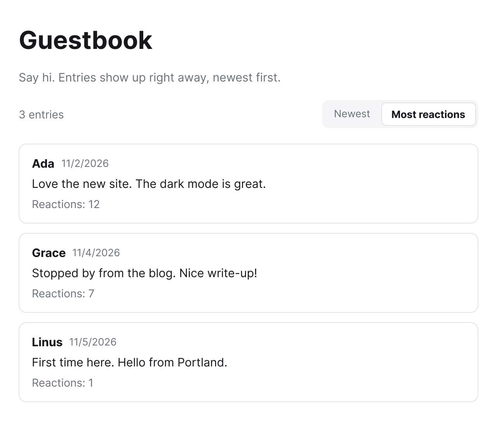

<Note>
Cette page est un brouillon pour le lancement du livre d'or le 5 novembre 2026. Tout ce qui concerne le lancement arrive sur la branche `release/guestbook` et est fusionné le jour du lancement.
</Note>

## Aperçu

Le livre d'or permet aux visiteurs de laisser une courte note sur votre site personnel 👋. Chaque entrée a un nom et un message. Les entrées sont affichées de la plus récente à la plus ancienne, 20 par page.

Pour l'instant, les entrées sont stockées dans le navigateur du visiteur (`localStorage`), donc chaque navigateur ne voit que les entrées signées depuis celui-ci.

## L'activer

Le livre d'or est désactivé par défaut. Pour l'activer, définissez la variable d'environnement `REACT_APP_GUESTBOOK` sur `on` lors de la compilation du site :

```bash .env
REACT_APP_GUESTBOOK=on
```

Toute autre valeur, ou une variable non définie, laisse le livre d'or désactivé. Comme Create React App lit les variables `REACT_APP_` à la compilation, recompilez et redéployez le site après l'avoir modifiée.

## Signer le livre d'or

Une fois le livre d'or activé, les visiteurs le trouvent à l'adresse `/guestbook`. Quand il est désactivé, cette adresse affiche la page **Not Found** habituelle du site.

Pour le signer, un visiteur :

1. Saisit son nom dans le champ **Name**.
2. Écrit une note dans le champ **Message**. Un compteur sous le champ indique combien des 280 caractères sont utilisés.
3. Clique sur **Sign the guestbook**.

La nouvelle entrée apparaît immédiatement en haut de la liste ✍️, sauf si elle est retenue pour vérification (voir [Modération](#modération)). Le champ du message se vide après une signature réussie, et le nom reste rempli. Si une vérification échoue, le message d'erreur apparaît au-dessus du bouton et rien n'est enregistré.

Sous le formulaire, une barre affiche le nombre total d'entrées publiées à gauche et le sélecteur de tri à droite. Viennent ensuite les entrées, chacune avec son nom, sa date de signature et son message.

### Réactions

Chaque entrée a quatre boutons de réaction : 👋 ❤️ 🔥 😂. Un clic sur l'un d'eux ajoute une réaction à cette entrée, et le bouton affiche le total à côté de l'emoji. Les visiteurs peuvent réagir autant de fois qu'ils le souhaitent.

### Tri

Le sélecteur de tri au-dessus de la liste propose deux options :

- **Newest** (par défaut) affiche les entrées de la plus récente à la plus ancienne.
- **Most reactions** affiche les entrées selon leur total de réactions sur les quatre emojis, du plus élevé au plus bas. Les entrées ayant le même total restent de la plus récente à la plus ancienne.

<Frame>
  
</Frame>

Le tri ne réordonne que les 20 entrées de la page actuelle 🔀. La pagination reste de la plus récente à la plus ancienne, donc **Most reactions** ne fait pas remonter les entrées populaires des pages précédentes. Le choix n'est pas enregistré : le sélecteur revient à **Newest** quand le visiteur recharge la page.

### Pagination

La page affiche 20 entrées à la fois, de la plus récente à la plus ancienne. Au-delà de 20, les boutons **Newer** et **Older** apparaissent sous la liste, avec **Page X of Y** entre les deux.

## Limites des entrées

Le livre d'or supprime les espaces en début et en fin des deux champs, puis vérifie chaque entrée avant de l'enregistrer.

| Champ     | Règle                    |
| --------- | ------------------------ |
| `name`    | Obligatoire. Jusqu'à 40 caractères. |
| `message` | Obligatoire. Jusqu'à 280 caractères. |

Quand une entrée échoue à une vérification, elle n'est pas enregistrée et le visiteur voit l'un de ces messages :

| Code               | Message affiché                             |
| ------------------ | ------------------------------------------- |
| `name_required`    | Add your name.                              |
| `name_too_long`    | Names are limited to 40 characters.         |
| `message_required` | Write a message.                            |
| `message_too_long` | Messages are limited to 280 characters.     |
| `rate_limited`     | You can sign 3 times a day. Come back tomorrow. |

### Limite quotidienne

Chaque navigateur peut signer le livre d'or 3 fois par jour. Le compteur est réinitialisé à minuit UTC. Les entrées retenues pour vérification comptent dans la limite, contrairement aux tentatives qui échouent à une vérification de champ.

## Modération

Par défaut, chaque entrée est publiée dès sa signature. Vous pouvez retenir des entrées pour vérification avec deux variables d'environnement facultatives. Comme `REACT_APP_GUESTBOOK`, elles sont lues à la compilation : recompilez le site après les avoir modifiées.

| Variable                               | Effet |
| -------------------------------------- | ----- |
| `REACT_APP_GUESTBOOK_BLOCKED_WORDS`    | Liste de mots séparés par des virgules. Une entrée dont le nom ou le message contient l'un d'eux (sans tenir compte de la casse) est retenue pour vérification au lieu d'être publiée. |
| `REACT_APP_GUESTBOOK_REQUIRE_APPROVAL` | Définissez-la sur `true` pour retenir toutes les entrées pour vérification. Toute autre valeur la laisse désactivée. |

```bash .env
REACT_APP_GUESTBOOK=on
REACT_APP_GUESTBOOK_BLOCKED_WORDS=spam, casino
REACT_APP_GUESTBOOK_REQUIRE_APPROVAL=true
```

Les mots bloqués correspondent n'importe où dans le texte, donc `spam` détecte aussi `spammer`.

Les entrées retenues n'apparaissent ni sur `/guestbook` ni dans son nombre d'entrées. Pour les vérifier, ouvrez `/guestbook/moderation`. La page **Guestbook moderation** liste chaque entrée retenue avec les boutons **Publish** et **Hide** :

- **Publish** ajoute l'entrée au livre d'or.
- **Hide** la garde hors du livre d'or.

Quand rien n'est retenu, la page affiche **Nothing waiting for review.** Comme `/guestbook`, la page de modération affiche **Not Found** quand le livre d'or est désactivé.

<Note>
Comme les entrées sont stockées dans le navigateur, la page de modération liste les entrées retenues enregistrées dans le navigateur où vous l'ouvrez.
</Note>

## Utiliser le livre d'or dans un composant

Le hook `useGuestbook` fournit à un composant la page actuelle d'entrées et une fonction `sign` pour en ajouter une.

```jsx
import { useGuestbook } from "../hooks/useGuestbook";

export default function GuestbookList() {
  const { entries, page, pages, goToPage, sign, error } = useGuestbook();

  const handleSubmit = (name, message) => {
    if (sign({ name, message })) {
      // Saved. The list refreshes on the current page.
    }
  };

  return (
    <div>
      {entries.map((entry) => (
        <p key={entry.id}>
          <strong>{entry.name}</strong>: {entry.message}
        </p>
      ))}
      {error && <p role="alert">{error}</p>}
      <button disabled={page >= pages} onClick={() => goToPage(page + 1)}>
        Older entries
      </button>
    </div>
  );
}
```

Le hook renvoie :

| Valeur     | Type     | Description                                                                 |
| ---------- | -------- | --------------------------------------------------------------------------- |
| `entries`  | object[] | Entrées publiées de la page actuelle. Chacune a `id`, `name`, `message` et `createdAt`. |
| `total`    | number   | Nombre d'entrées publiées sur toutes les pages.                              |
| `pages`    | number   | Nombre de pages. Toujours au moins `1`.                                      |
| `page`     | number   | Page actuelle, à partir de `1`.                                              |
| `goToPage` | function | Charge le numéro de page indiqué.                                            |
| `sign`     | function | Valide et enregistre `{ name, message }`. Renvoie `true` quand l'entrée est enregistrée, y compris si elle est retenue pour vérification, et `false` quand une vérification ou la limite quotidienne l'en empêche. |
| `error`    | string   | Message du dernier appel `sign` en échec, ou une chaîne vide.                |
