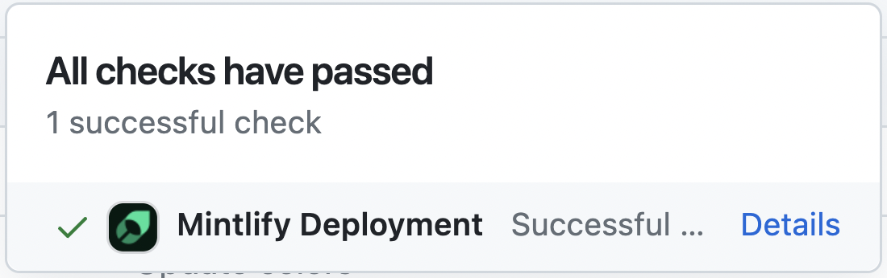

<Info>
  **前提条件**:
  - Node.js バージョン 19 以上
  - `docs.json` ファイルを含むドキュメントリポジトリ
</Info>

以下の手順に従って、お使いのオペレーティングシステムに Mintlify をインストールして実行します。

<Steps>
<Step title="Mintlify CLI をインストールする">

```bash
npm i -g mint
```
</Step>

<Step title="ローカルでプレビューする">

`docs.json` ファイルがあるドキュメントディレクトリに移動し、次のコマンドを実行します。

```bash
mint dev
```

ドキュメントのローカルプレビューが `http://localhost:3000` で利用できるようになります。

</Step>
</Steps>

## カスタムポート {#custom-ports}

デフォルトでは、Mintlify はポート 3000 を使用します。`--port` フラグを使うと、Mintlify を実行するポートをカスタマイズできます。たとえば、ポート 3333 で Mintlify を実行するには、次のコマンドを使用します。

```bash
mint dev --port 3333
```

すでに使用中のポートで Mintlify を実行しようとすると、次に利用可能なポートが使用されます。

```md
Port 3000 is already in use. Trying 3001 instead.
```

## Mintlify のバージョン {#mintlify-versions}

各 CLI リリースは、特定のバージョンの Mintlify に対応しています。ローカルプレビューが本番環境のバージョンと一致しない場合は、CLI を更新してください。

```bash
npm mint update
```

## リンクの検証 {#validating-links}

CLI を使用して、ドキュメント内のリンク切れを検出します。

```bash
mint broken-links
```

## デプロイ {#deployment}

デプロイが成功すると、次のように表示されます。

<Frame>
  
</Frame>

## コードのフォーマット {#code-formatting}

MDX を認識してフォーマットするために、IDE の拡張機能を使用することをおすすめします。VSCode をお使いの場合は、シンタックスハイライト用の [MDX VSCode 拡張機能](https://marketplace.visualstudio.com/items?itemName=unifiedjs.vscode-mdx)と、コードフォーマット用の [Prettier](https://marketplace.visualstudio.com/items?itemName=esbenp.prettier-vscode) の利用を検討してください。

## トラブルシューティング {#troubleshooting}

<AccordionGroup>
  <Accordion title='エラー: darwin-arm64 ランタイムで "sharp" モジュールを読み込めませんでした'>

    これは Node のバージョンが古いことが原因である可能性があります。次の手順を試してください。
    1. 現在インストールされている CLI を削除します: `npm remove -g mint`
    2. Node v19 以上にアップグレードします。
    3. CLI を再インストールします: `npm i -g mint`
  </Accordion>

  <Accordion title="問題: 不明なエラーが発生する">
  
    解決策: デバイスのルートに移動し、`~/.mintlify` フォルダーを削除します。その後、再度 `mint dev` を実行します。
  </Accordion>
</AccordionGroup>

最新の CLI バージョンでの変更点が気になりますか？ [CLI の変更履歴](https://www.npmjs.com/package/mintlify?activeTab=versions)をご覧ください。
